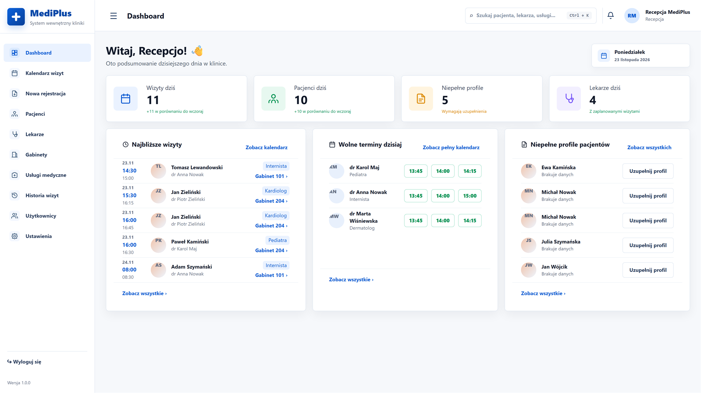
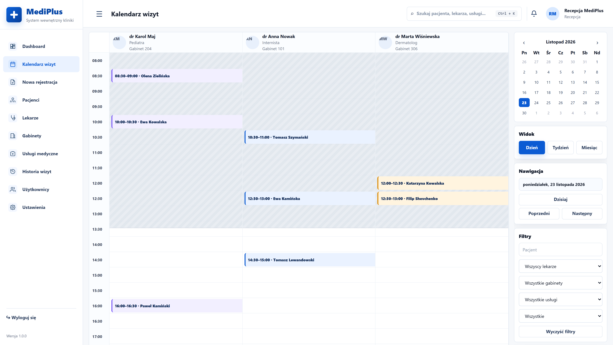
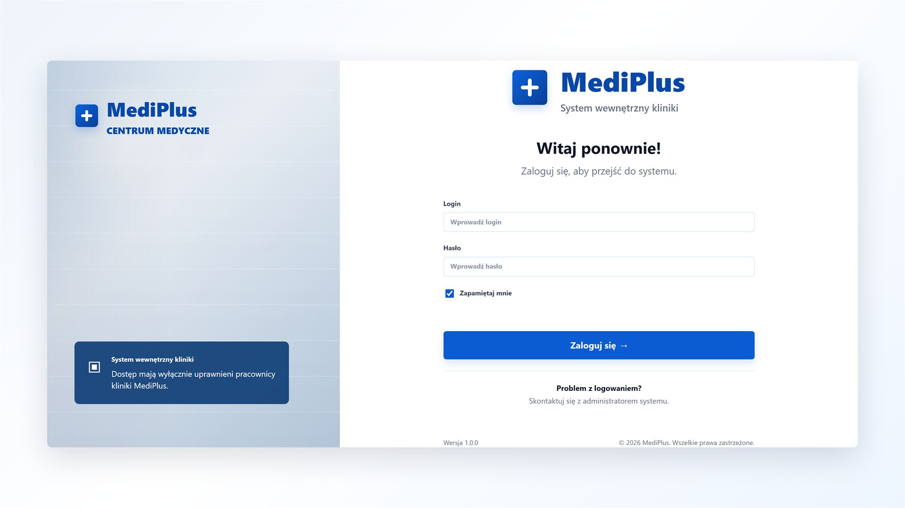
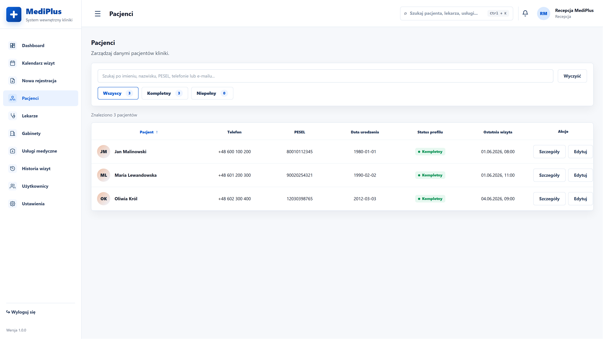
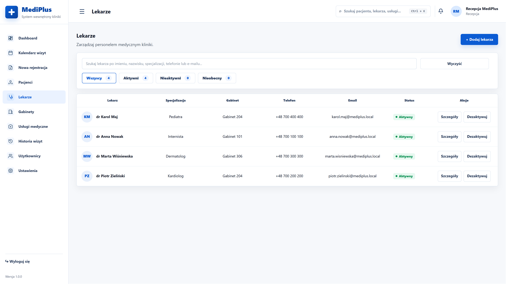
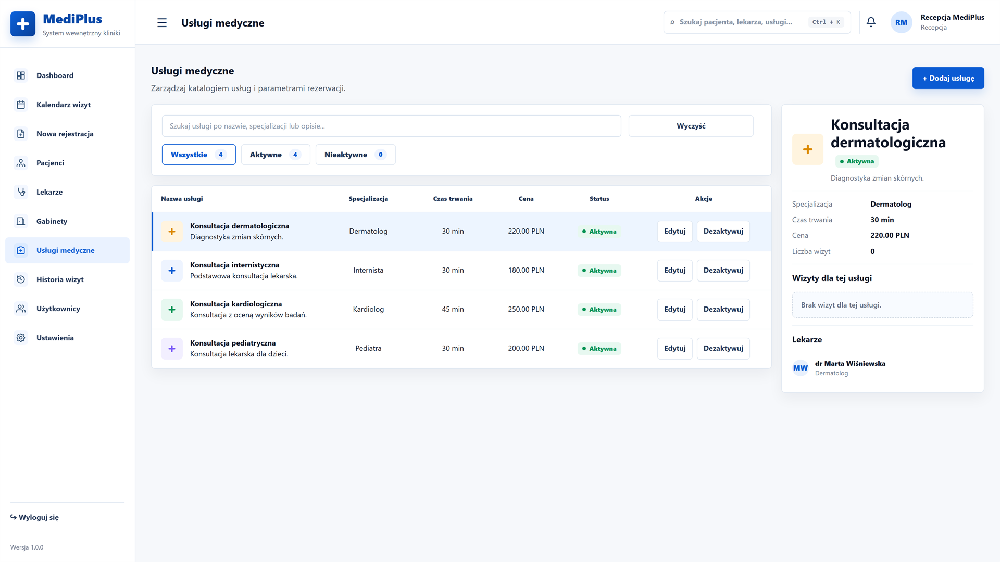
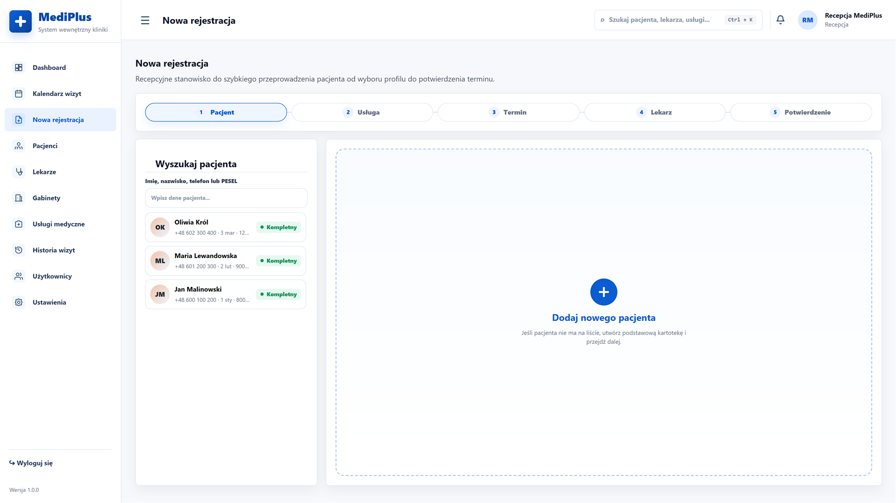
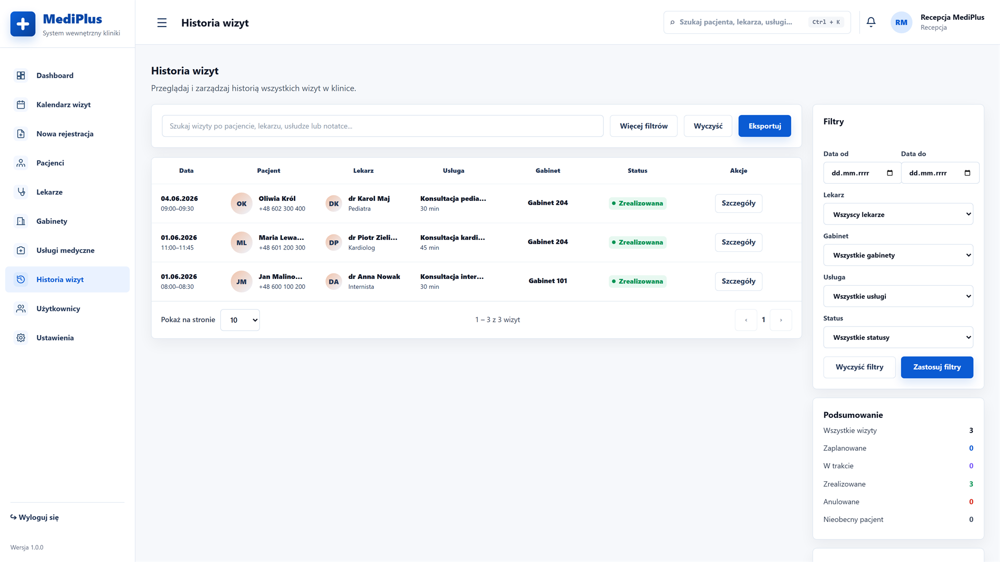

# MediPlus — clinic appointment system

An appointment system for a small clinic: patients, doctors, cabinets,
services, working hours, absences and visit history. PHP backend with PDO and
MySQL, plus a static HTML/CSS/JavaScript front end. Personal project.

> **All data is fictional.** Every patient, doctor, login and phone number in
> this repository was made up for the demo. No real patient, medical record or
> personal data is stored or published here. `database.sql` contains the demo
> accounts and settings; replace their passwords before any real use.

## Status

Working prototype. The API is implemented against MySQL, and the front end talks
to it: sign-in goes through `backend/api/auth.php`, and the patients, doctors,
services and visit history screens load their rows from the API. Screens that
are not yet exercised end to end are listed under *Known gaps*.

## Features

- **Users and roles** — reception, doctor and administrator accounts with hashed
  passwords (`password_hash`), status and forced password change flag.
- **Scheduling** — appointments with date, start and end time, doctor, cabinet
  and medical service; overlap policy configurable in appointment settings.
- **Patients** — registration with contact details, PESEL, address, notes.
- **Clinicians** — doctors with specializations, cabinets, absences, clinic
  working hours per weekday.
- **Services** — medical services with duration, price and active flag.
- **Notifications** — internal per-user notification centre with recipients.
- **Email** — SMTP settings and sending appointment confirmations.
- **Data exchange** — CSV import and export of patients and appointments.
- **Settings** — clinic details and appointment/security policy stored as JSON.

## Screenshots

Taken against a demo database filled by `database/seed_demo.php` (50 patients,
a few months of visits), with the seeded demo account. Every patient, doctor and
phone number below is fictional.

**Dashboard** — today's appointments, today's patients, incomplete profiles and
the free slots left today.



**Calendar** — day and week view per doctor, with cabinets, filters and slot
occupancy.



**Sign-in** — session-based login against `auth.php`.



**Patients** — search, profile completeness filter, last visit, PESEL and contact
details.



**Doctors** — specialisation, cabinet, contact and status per clinician.



**Medical services** — catalogue with duration, price and a live preview panel.



**New registration** — the five-step reception flow: patient, service, slot,
doctor, confirmation.



**Visit history** — filters by date, doctor, cabinet, service and status, with a
summary and CSV export.



## Stack

| Layer | Choice |
|---|---|
| Language | PHP 8, `declare(strict_types=1)` in the API files |
| Database | MySQL 8, InnoDB, utf8mb4, PDO prepared statements, foreign keys |
| Frontend | Static HTML, CSS and vanilla JavaScript |
| Integrations | SMTP, CSV |

## Data model

15 tables in `database.sql`:

`roles`, `users`, `specializations`, `cabinets`, `patients`, `doctors`,
`doctor_absences`, `clinic_working_hours`, `appointment_settings`,
`system_settings`, `notifications`, `notification_recipients`,
`medical_services`, `appointments`, `visit_history`.

## API

All endpoints live under `backend/api/` and speak JSON:

| Endpoint | Methods | Purpose |
|---|---|---|
| `auth.php` | POST | login |
| `patients.php` | GET, POST | list and create patients |
| `doctors.php` | GET | list doctors with specializations |
| `cabinets.php` | GET | list cabinets |
| `doctor_absences.php` | GET, POST | doctor absences |
| `services.php` | GET | medical services |
| `appointments.php` | GET, POST, PATCH, PUT | list, book, change status |
| `notifications.php` | GET, POST | notification centre |
| `email.php` | POST | send an e-mail |
| `email_settings.php` | GET, POST | SMTP configuration |
| `settings.php` | GET, POST | clinic and system settings |
| `users.php` | GET, POST | staff accounts |
| `export.php` | GET | CSV export |
| `import.php` | POST | CSV import |

`backend/index.php` returns the endpoint list as JSON and is handy for a quick
check that PHP and Apache are wired up.

## Getting started

### Requirements

- PHP 8+ with `pdo_mysql`
- MySQL 8.0+
- Apache (developed on XAMPP)

### 1. Database

```bash
mysql -u root -p < database.sql
```

This creates the `mediplus` database, its tables, the weekly opening hours, the
default appointment settings and a few demo accounts.

### 2. Configuration

Edit `backend/config/database.php` for your local MySQL host, database name,
user and password. The file ships with local defaults only and contains no
secrets.

### 3. Run

Copy the project into the Apache document root and open `index.html`, or serve
it directly:

```bash
php -S localhost:8080
```

### 4. Demo data (optional, separate database)

`database.sql` seeds only three patients, which leaves the dashboard and the
calendar empty. `database/seed_demo.php` fills a throwaway copy with fictional
patients and a few months of visits.

```bash
mysql -u root -p -e "CREATE DATABASE mediplus_demo CHARACTER SET utf8mb4 COLLATE utf8mb4_unicode_ci"

# database.sql starts with CREATE DATABASE/USE mediplus — strip those lines so the
# import lands in the demo database instead of the working one.
sed -E '/^CREATE DATABASE/d; /^  CHARACTER SET/d; /^  COLLATE/d; /^USE `/d' \
  database.sql > /tmp/mediplus_demo_schema.sql
mysql -u root -p mediplus_demo < /tmp/mediplus_demo_schema.sql

export DEMO_DSN="mysql:host=127.0.0.1;dbname=mediplus_demo;charset=utf8mb4"
export DEMO_USER=root
export DEMO_PASS=""

php database/seed_demo.php --list   # tables and row counts found in the demo database
php database/seed_demo.php          # generate the demo set
```

The seeder refuses to run unless the database name contains `demo`, `dev`,
`test`, `seed` or `sandbox`, and it explicitly refuses `mediplus`. Point
`backend/config/database.php` at the demo database before opening the front end.

### Demo accounts

`database.sql` seeds accounts such as `recepcja` and `anna.nowak` with
`@mediplus.local` addresses. They share one demo password hash — set new
passwords for every account before using the system with real data.

## Demo data

`database/seed_demo.php` generates, deterministically (`mt_srand`):

- 50 patients with invented names, valid-checksum PESEL numbers, `+48 5xx`
  phones and `@example.com` addresses (45 complete profiles, 5 incomplete on
  purpose so the dashboard card is not always zero)
- about 1 300 appointments over four months back and two weeks ahead, with
  completed, cancelled and no-show visits in the past and planned visits in the
  future
- visit history with a diagnosis and recommendations for every completed visit
- three future doctor absences

Counts are configurable: `--patients=60 --months=5 --days-ahead=21`. Re-running
needs `--reset --yes`, because the generator is deterministic and would collide
on PESEL and e-mail.

## Known gaps (in progress)

- some screens (e-mail settings, notifications, CSV import/export) have not been
  exercised end to end through the UI yet
- no session-based authentication middleware: `auth.php` checks credentials but
  the endpoints do not enforce a session
- no automated tests yet
- no migration tool
- CSRF tokens are not on every form

## Contact

Artem Vitiaz — Bydgoszcz, Poland
[github.com/ShiBro360](https://github.com/ShiBro360) · shibro36@gmail.com
